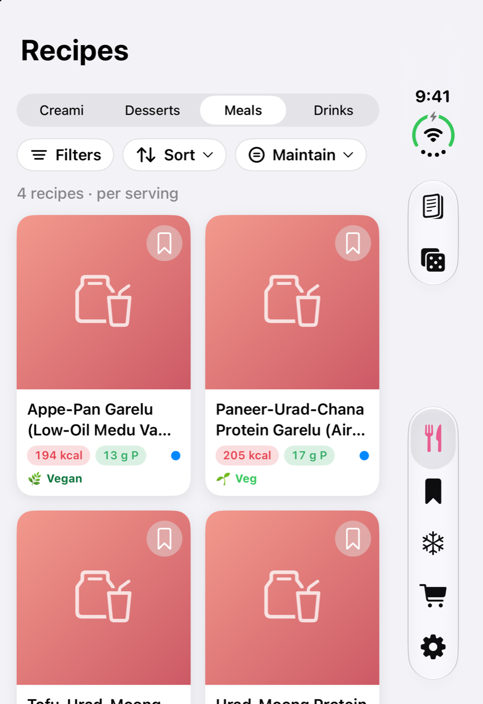
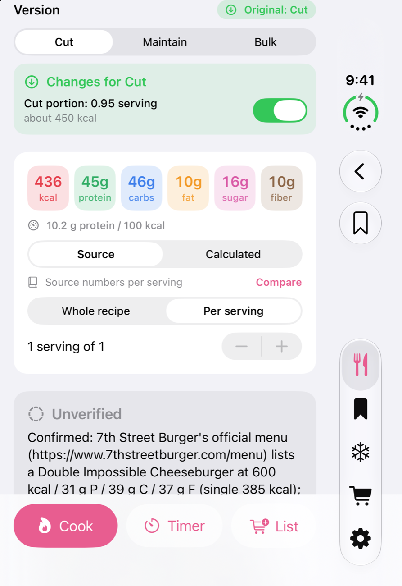
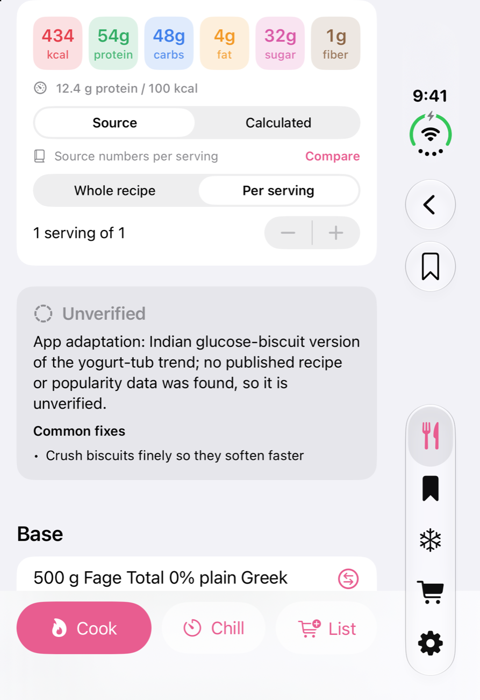
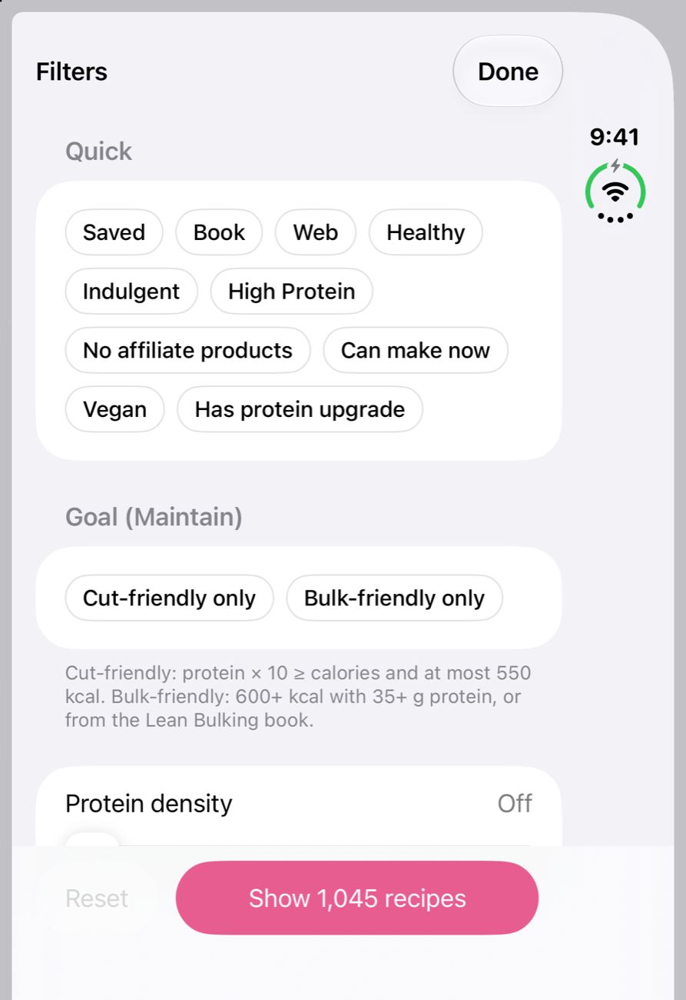
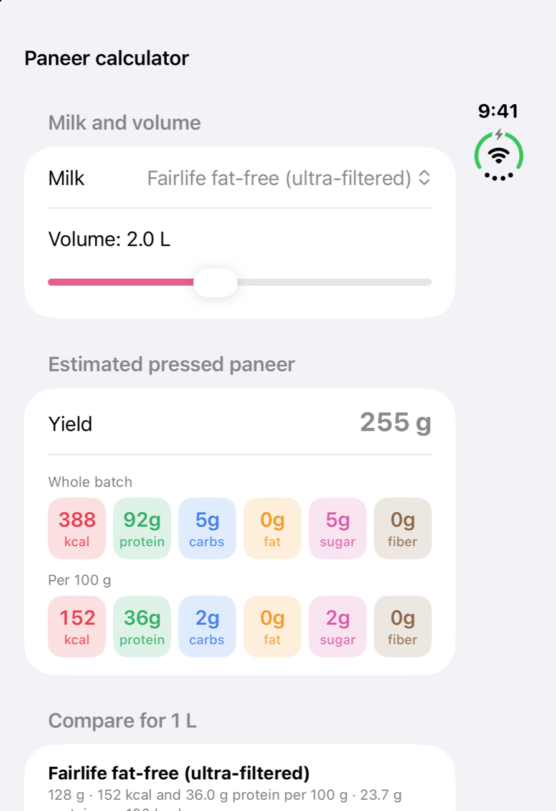
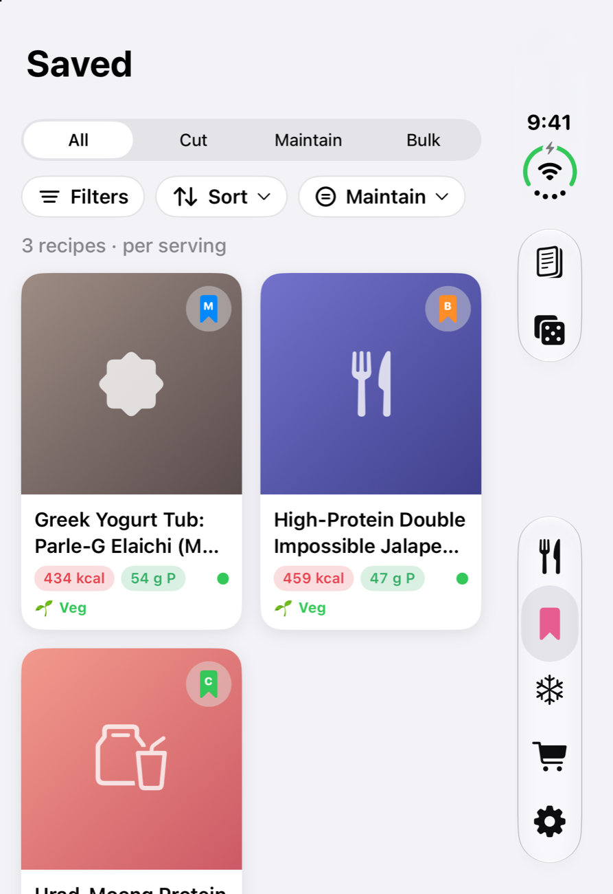

# Macro Kitchen

A personal SwiftUI iPhone app for **high-protein, vegetarian cooking**: Ninja Creami pints, meals, desserts and drinks. Every number follows what you actually cook with: your milk, your protein powder, your swaps and your goal (cut, maintain or bulk).

<p align="center">
  
  
  
</p>
<p align="center">
  
  
  
</p>

## What it does

### Recipes and browsing
- **Four sections:** Creami, Desserts, Meals and Drinks, covering about 1,600 recipes on the owner's device (see [Data](#data)).
- **Search** across names, ingredients, tags and sources.
- **A clean filter bar:** Filters, Sort and Goal, plus removable pills for each active filter.
- **Filters:**
  - course and cuisine (Pizza, Wings, Tofu, Paneer, Pasta, Noodles, Indian, Indo-Chinese, Chinese, Thai, Korean, Ramen, Sushi…);
  - tags, books and dessert type;
  - macro sliders and protein density ("protein × N ≥ calories");
  - high fiber, vegetarian, vegan, no egg and allergens;
  - pantry ("can make now");
  - "has protein upgrade".
- **Sorts:** Featured, Healthiest (protein per 100 kcal), Protein, Calories, High fiber, Quickest, Rating and Recently made.

### Goals: cut, maintain, bulk
- Every recipe gets a badge ("Original: Cut / Maintain / Bulk") and a **Version** switch.
- **Cut** applies lighter swaps (lower-fat dairy, light cheese, sweetener…), halves the cooking fat and trims the portion to a calorie target.
- **Bulk** adds richer swaps, a bigger portion and optional add-ons.
- Every change is listed and can be turned off on its own.
- Saved recipes are tagged with the goal you saved them for (C / M / B), and you can rate recipes 1–5 stars.

### Nutrition that follows your kitchen
- **Pickers** for milk (Fairlife, skim, 2%, oat, almond, protein shakes…), protein powder (about 20 brands) and Greek yogurt (defaults to 0%). Each recalculates the macros.
- **Choose where the numbers come from:** the recipe's own figures, or an ingredient-level calculation from an 880+ item catalog, plus Open Food Facts barcode lookup or a typed-in label.
- **Estimated amounts** for lines with no quantity, clearly marked "≈ est.", which you can override.
- **Guaranteed sane numbers:** changes are scaled to the recipe's real totals, so no version can ever show negative macros. A test sweeps every recipe in every version.

### Vegetarian first
- Meat recipes open as **protein-matched vegetarian versions** with rewritten steps.
- **Ranked alternatives** for each meat (seitan, tofu, paneer, soy chunks, plant mince…), each with an availability badge (Everywhere / Most stores / Specialty), where to buy, brands and prep.
- **Protein upgrade** for wings and crispy bites: cauliflower → tofu, paneer, seitan or soy chunks, with the title and macros updated.
- **"Add protein" boosts** for plain overnight oats: a scoop of protein powder, Greek yogurt, skyr or cottage cheese.
- **Warnings for hidden non-vegetarian ingredients** (gelatin, collagen, fish sauce, Worcestershire, animal-rennet cheese, ramen flavor packets…), plus a **Vegan** badge when everything is plant-based.

### Clear ingredients
- Store-bought and homemade alternatives, and swaps for anything you don't have.
- ⓘ notes for specialty ingredients, and US names next to UK terms ("cornflour (cornstarch)", "rocket (arugula)").

### In the kitchen
- **Cook mode** with step-by-step pages, and the screen stays awake.
- **Freeze, chill and cook timers** with notifications.
- **Shopping list** that merges ingredients across recipes, with your swaps applied.
- **Pantry tracker** and a made-it log.

### Guides
- **High-protein paneer**, with a yield and macro calculator for each milk.
- Vegetarian protein sources, a meat-swap guide, homemade seitan, tofu basics, hidden non-veg ingredients, and the best-tasting protein powders for cooking.

## Data
Recipe content is **not in this repository**. The app is built from local files that stay on the owner's machine (see `.gitignore`): personally owned recipe books, and recipes collected from creators' websites, which link back to their sources. Screenshots only show the app's own adaptations and screens.

The repository contains the app, the build and check tools, and original data: the ingredient catalog, milks, protein powders, vegetarian alternatives, guides and the paneer model.

To build with your own data, put recipe JSON in `data/` as described in `docs/SPEC.md`, then run:

```bash
python3 -I tools/build_data.py        # builds CreamiCravings/Resources/recipes.json
python3 -I tools/check_data_fixes.py  # vegetarian-safety and data checks
tools/logic_checks/run.sh             # logic tests (no Xcode needed)
tools/screenshots.sh                  # regenerate the README screenshots (Debug only)
```

## Building
1. `cp Signing.xcconfig.example Signing.xcconfig`, then put your Apple Developer Team ID in it.
2. Open `CreamiCravings.xcodeproj` in Xcode 26 or later and run it on an iPhone (iOS 18+).

Built with SwiftUI and Apple frameworks only, with no third-party packages.
